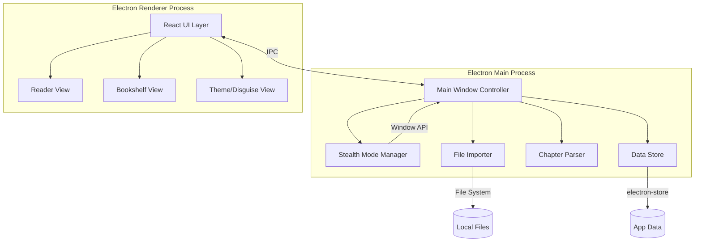

# Design Document

## Overview

隐蔽小说阅读器（Stealth Novel Reader）是一款基于 Electron 的桌面应用，专为办公场景设计。核心特性是高度隐蔽性——当鼠标移出阅读区域或按下快捷键时，窗口在 200ms 内隐藏，不留任何可见痕迹。应用支持导入 TXT 小说文件（自动识别 UTF-8/GBK 编码）、自动章节划分、书架管理和舒适的阅读体验。

**技术选型决策：**

- **Electron**：选择 Electron 而非 Tauri，因为 Electron 对窗口透明度、隐藏/显示、任务栏控制等底层窗口操作有成熟的 API 支持（`BrowserWindow.setOpacity()`、`win.hide()`、`skipTaskbar` 等），这对隐蔽模式至关重要。
- **React + TypeScript**：前端使用 React 构建 UI，TypeScript 提供类型安全。
- **electron-store**：用于持久化书架数据和阅读进度，比 localStorage 更可靠（不受进程终止影响）。
- **chardet**：用于自动检测文件编码（UTF-8/GBK）。
- **iconv-lite**：用于 GBK 编码文件的解码转换。

## Architecture



**架构决策：**

1. **Main/Renderer 分离**：隐蔽模式的窗口控制（hide/show/opacity）必须在 Main Process 中执行，因为 Renderer 无法直接操作 BrowserWindow。
2. **IPC 通信**：Renderer 通过 `ipcRenderer.invoke` 与 Main Process 通信，Main Process 通过 `webContents.send` 推送事件。
3. **数据持久化在 Main Process**：使用 electron-store 在 Main Process 中管理数据，避免 Renderer 进程崩溃导致数据丢失。

## Components and Interfaces

### 1. Stealth Mode Manager（隐蔽模式管理器）

负责窗口的隐藏/显示逻辑，包括鼠标检测和快捷键响应。

```typescript
interface StealthModeManager {
  // 初始化隐蔽模式，注册鼠标监听和快捷键
  initialize(window: BrowserWindow, config: StealthConfig): void;
  
  // 隐藏窗口（200ms 内完成）
  hide(): void;
  
  // 显示窗口（200ms 内完成）
  show(): void;
  
  // 获取当前隐蔽状态
  isHidden(): boolean;
  
  // 设置伪装主题
  setDisguise(theme: DisguiseTheme): void;
  
  // 销毁监听器
  destroy(): void;
}

interface StealthConfig {
  hideShortcut: string;          // 快捷键，默认 "CommandOrControl+Shift+H"
  mouseLeaveDelay: number;       // 鼠标移出后延迟隐藏时间（ms），默认 0
  hideAnimation: 'opacity' | 'hide';  // 隐藏方式
}

type DisguiseTheme = 'code-editor' | 'terminal';
```

### 2. File Importer（文件导入器）

负责文件选择、编码检测和内容读取。

```typescript
interface FileImporter {
  // 打开文件选择对话框，返回导入结果
  importFile(): Promise<ImportResult>;
  
  // 检测文件编码
  detectEncoding(filePath: string): Promise<EncodingType>;
  
  // 读取并解码文件内容
  readFileContent(filePath: string, encoding: EncodingType): Promise<string>;
}

interface ImportResult {
  success: boolean;
  book?: BookData;
  error?: ImportError;
}

interface ImportError {
  code: 'INVALID_FORMAT' | 'EMPTY_FILE' | 'UNSUPPORTED_ENCODING' | 'FILE_TOO_LARGE';
  message: string;
}

type EncodingType = 'utf-8' | 'gbk';
```

### 3. Chapter Parser（章节解析器）

负责自动识别和划分章节。

```typescript
interface ChapterParser {
  // 解析文本内容，返回章节列表
  parse(content: string): Chapter[];
}

interface Chapter {
  title: string;       // 章节标题
  offset: number;      // 起始字符偏移量
  length: number;      // 章节内容长度（字符数）
}

// 章节标题匹配模式
const CHAPTER_PATTERNS: RegExp[] = [
  /^第[一二三四五六七八九十百千万零\d]+[章节]/m,   // "第X章" / "第X节"
  /^Chapter\s*\d+/im,                              // "Chapter N"
  /^\d+[.\s]+\S+/m,                                // "1. 标题" / "1 标题"
];
```

### 4. Bookshelf Manager（书架管理器）

负责小说列表管理和阅读进度持久化。

```typescript
interface BookshelfManager {
  // 获取所有书籍
  getAllBooks(): BookMeta[];
  
  // 添加书籍
  addBook(book: BookData): BookMeta;
  
  // 删除书籍
  removeBook(bookId: string): void;
  
  // 更新阅读进度
  updateProgress(bookId: string, progress: ReadingProgress): void;
  
  // 获取阅读进度
  getProgress(bookId: string): ReadingProgress | null;
  
  // 更新书名
  updateTitle(bookId: string, newTitle: string): void;
}

interface BookMeta {
  id: string;                    // 唯一标识（UUID）
  title: string;                 // 书名（最长 50 字符）
  filePath: string;              // 文件路径
  fileSize: number;              // 文件大小（字节）
  chapters: Chapter[];           // 章节目录
  addedAt: number;               // 添加时间戳
  lastReadAt: number;            // 最后阅读时间戳
}

interface ReadingProgress {
  chapterIndex: number;          // 当前章节索引
  scrollPosition: number;        // 滚动位置（像素）
  percentage: number;            // 阅读百分比（0-100 整数）
}

interface BookData {
  fileName: string;              // 文件名（不含扩展名）
  filePath: string;              // 文件完整路径
  content: string;               // 文件文本内容
  fileSize: number;              // 文件大小
  encoding: EncodingType;        // 检测到的编码
}
```

### 5. Reader Controller（阅读控制器）

负责阅读界面的状态管理和自动保存。

```typescript
interface ReaderController {
  // 打开书籍并恢复进度
  openBook(bookId: string): Promise<void>;
  
  // 跳转到指定章节
  goToChapter(chapterIndex: number): void;
  
  // 更新滚动位置
  updateScrollPosition(position: number): void;
  
  // 设置字体大小（12-48px，步长 2px）
  setFontSize(size: number): void;
  
  // 设置字体
  setFontFamily(font: string): void;
  
  // 获取当前阅读百分比
  getPercentage(): number;
  
  // 启动自动保存（每 30 秒）
  startAutoSave(): void;
  
  // 停止自动保存
  stopAutoSave(): void;
}
```

### IPC 通信协议

```typescript
// Main -> Renderer 事件
type MainToRendererEvents = {
  'stealth:hidden': void;
  'stealth:shown': void;
  'autosave:failed': { message: string };
};

// Renderer -> Main 调用
type RendererToMainInvokes = {
  'file:import': () => ImportResult;
  'bookshelf:getAll': () => BookMeta[];
  'bookshelf:remove': (bookId: string) => void;
  'bookshelf:updateProgress': (bookId: string, progress: ReadingProgress) => void;
  'bookshelf:updateTitle': (bookId: string, title: string) => void;
  'reader:getContent': (bookId: string) => string;
  'stealth:setDisguise': (theme: DisguiseTheme) => void;
  'stealth:hide': () => void;
  'settings:setFontSize': (size: number) => void;
  'settings:setFontFamily': (font: string) => void;
};
```

## Data Models

### 持久化数据结构（electron-store）

```typescript
interface AppStore {
  books: BookMeta[];              // 书架中所有书籍的元数据
  settings: AppSettings;          // 应用设置
  fileContents: {                 // 文件内容缓存（按 bookId 索引）
    [bookId: string]: string;
  };
}

interface AppSettings {
  fontSize: number;               // 字体大小，默认 16px
  fontFamily: string;             // 字体，默认 "Consolas, monospace"
  disguiseTheme: DisguiseTheme;   // 伪装主题，默认 'code-editor'
  hideShortcut: string;           // 隐藏快捷键
  autoSaveInterval: number;       // 自动保存间隔（ms），默认 30000
}
```

### 文件存储策略

- **小文件（≤5MB）**：内容直接存储在 electron-store 中，随应用数据一起持久化。
- **大文件（>5MB）**：内容存储在应用数据目录下的独立文件中（`{appData}/books/{bookId}.txt`），electron-store 仅存储元数据和文件路径引用。


## Correctness Properties

*A property is a characteristic or behavior that should hold true across all valid executions of a system—essentially, a formal statement about what the system should do. Properties serve as the bridge between human-readable specifications and machine-verifiable correctness guarantees.*

### Property 1: Hide/Show 状态保持

*For any* 阅读状态（包含任意章节索引和任意滚动位置），执行隐藏再显示操作后，阅读状态（章节索引和滚动位置）应与隐藏前完全一致。

**Validates: Requirements 1.2, 1.6**

### Property 2: 编码检测与解码 Round-Trip

*For any* 有效的 Unicode 文本字符串，将其编码为 UTF-8 或 GBK 字节流后，经过编码检测和解码管道处理，输出应与原始文本字符串相等。

**Validates: Requirements 2.2**

### Property 3: 非 TXT 文件拒绝

*For any* 文件路径，若其扩展名不是 `.txt`（不区分大小写），则文件导入验证应返回 `INVALID_FORMAT` 错误，且不将任何数据添加到书架。

**Validates: Requirements 2.3**

### Property 4: 文件名到书名提取

*For any* 有效的 `.txt` 文件路径，导入后的默认书名应等于文件名去除 `.txt` 扩展名后的部分。

**Validates: Requirements 2.5**

### Property 5: 章节标题模式识别

*For any* 包含已定义章节标题模式（"第X章"、"第X节"、"Chapter N"、"N. 标题"）的文本，章节解析器应识别出所有匹配的章节标题，且不遗漏任何匹配项。

**Validates: Requirements 3.2**

### Property 6: 章节偏移量正确性与顺序

*For any* 经过章节解析的文本，每个章节条目的 offset 值应指向原始文本中该章节标题的实际起始位置，且章节目录中的条目应按 offset 值严格递增排列。

**Validates: Requirements 3.3, 3.7**

### Property 7: 无章节标记时的等分分段

*For any* 不包含任何已定义章节标题模式的文本（长度 > 0），章节解析器应将其按每 3000 字符分段，每段标题为"第 N 段"（N 从 1 递增），且所有段的内容拼接后应等于原始文本。

**Validates: Requirements 3.4**

### Property 8: 书架数据持久化 Round-Trip

*For any* 书架状态（包含任意数量的书籍及其阅读进度），执行保存后再加载，恢复的书架状态应与保存前的状态完全一致（书籍列表、每本书的元数据和阅读进度均相等）。

**Validates: Requirements 4.2, 4.4, 4.5**

### Property 9: 书籍删除完整性

*For any* 包含至少一本书的书架，删除其中一本书后，该书的元数据和阅读进度均不应存在于书架中，且其余书籍不受影响。

**Validates: Requirements 4.3**

### Property 10: 书名长度验证

*For any* 字符串作为书名输入，若长度 ≤ 50 字符则应原样保存，若长度 > 50 字符则应截断为前 50 个字符并附加省略号（或拒绝），且保存后的书名长度不超过限制。

**Validates: Requirements 4.6, 4.7**

### Property 11: 字体大小范围与步长验证

*For any* 字体大小数值输入，系统应将其约束在 [12, 48] 范围内，且结果为 2 的倍数（即有效值为 12, 14, 16, ..., 46, 48）。

**Validates: Requirements 5.3**

### Property 12: 阅读进度百分比计算

*For any* 书籍总长度（> 0）和当前阅读位置（0 ≤ position ≤ totalLength），计算出的阅读百分比应为 [0, 100] 范围内的整数，且 position = 0 时百分比为 0，position = totalLength 时百分比为 100。

**Validates: Requirements 5.4**

## Error Handling

### 文件导入错误

| 错误场景 | 错误码 | 用户提示 | 系统行为 |
|---------|--------|---------|---------|
| 文件格式非 .txt | `INVALID_FORMAT` | "仅支持 .txt 格式文件" | 不添加到书架 |
| 文件为空（0 字节） | `EMPTY_FILE` | "文件内容为空" | 不添加到书架 |
| 编码不支持 | `UNSUPPORTED_ENCODING` | "文件编码不支持，仅支持 UTF-8 和 GBK" | 不添加到书架 |
| 文件超过 50MB | `FILE_TOO_LARGE` | "文件过大，最大支持 50MB" | 不执行导入 |

### 自动保存错误

- 保存失败时在界面底部显示非阻塞提示（toast），提示内容："保存失败，将在 30 秒后重试"
- 30 秒后自动重试，重试成功则清除提示
- 连续失败 3 次后停止重试，提示用户手动保存

### 章节解析错误

- 解析过程中遇到异常时，回退到按 3000 字分段的策略
- 不中断用户的导入流程

### 窗口操作错误

- 隐藏/显示操作失败时静默处理（不弹出错误提示，避免暴露阅读器存在）
- 记录错误日志到应用数据目录

## Testing Strategy

### 单元测试（Example-Based）

使用 **Vitest** 作为测试框架，覆盖以下场景：

- **Stealth Mode**：验证隐藏/显示时窗口属性正确设置（opacity、skipTaskbar）
- **File Importer**：验证文件对话框过滤器配置、空文件处理、超大文件拒绝
- **Chapter Parser**：验证各种章节标题模式的具体匹配案例
- **Bookshelf**：验证空状态 UI、删除确认流程
- **Reader**：验证键盘/滚轮导航、默认字体设置

### 属性测试（Property-Based）

使用 **fast-check** 作为属性测试库，每个属性测试运行最少 100 次迭代。

测试标签格式：`Feature: stealth-novel-reader, Property {number}: {property_text}`

覆盖的属性：
1. Hide/Show 状态保持
2. 编码检测与解码 Round-Trip
3. 非 TXT 文件拒绝
4. 文件名到书名提取
5. 章节标题模式识别
6. 章节偏移量正确性与顺序
7. 无章节标记时的等分分段
8. 书架数据持久化 Round-Trip
9. 书籍删除完整性
10. 书名长度验证
11. 字体大小范围与步长验证
12. 阅读进度百分比计算

### 集成测试

- 文件导入完整流程（选择文件 → 编码检测 → 解析 → 添加到书架）
- 自动保存定时触发验证
- 性能测试：10MB 文件导入 < 3 秒，10MB 文件章节解析 < 3 秒

### 测试工具链

- **Vitest**：测试运行器和断言库
- **fast-check**：属性测试生成器
- **@testing-library/react**：React 组件测试
- **electron-mock**：Electron API 模拟（BrowserWindow、dialog 等）
